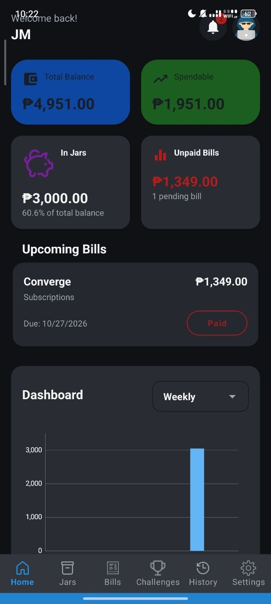
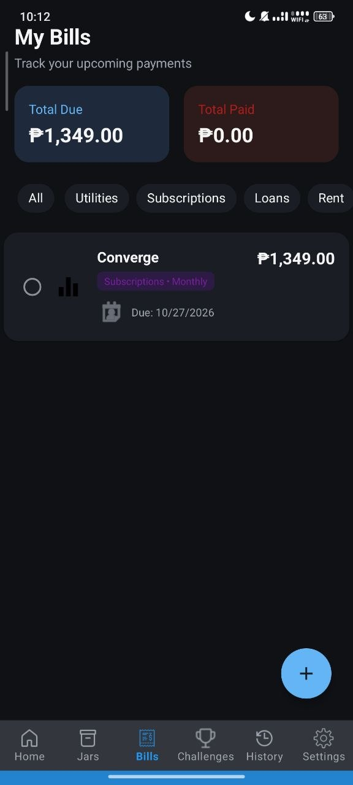

# FinTrac

**A personal finance tracker for Android.** Track where your money goes, never miss a bill, and reach your savings goals, alone or with friends through shared savings jars.

Built with Java and Firebase.

<!-- Add screenshots: put PNGs in docs/screenshots/ and uncomment the lines below.
<p>
  
  
  
</p>
-->

## Features

- **Income and expenses**: record transactions by category and see spending on a weekly, monthly, quarterly or yearly chart
- **Bills**: due dates, reminders, one-tap "mark as paid", and automatic archiving of paid overdue bills
- **Savings jars**: set a goal and a deadline and watch progress grow
  - **Shared jars**: invite friends by email; each member has a fair share, and contributions are tracked per person
  - Jars past their deadline move to Archives, where they can be restored for 30 days
- **Savings challenges**: for example "Daily ₱20 for 30 days", with a daily check-in that resets at 8:00 AM
- **History and reports**: filter by type and export Excel, CSV or PDF reports
- **Personalization**: multiple display currencies, dark mode, theme colors and profile avatars
- **Account control**: in-app account and data deletion

## Tech stack

| Area | Used |
| --- | --- |
| Language / platform | Java 17, Android SDK (min 30, target 35) |
| Backend | Firebase Authentication, Cloud Firestore, Cloud Messaging, App Check, Crashlytics, Analytics |
| Sign-in | Email + password with an emailed one-time code ([EmailJS](https://www.emailjs.com/)), Google Sign-In via Credential Manager |
| UI | XML layouts, Material Components, MPAndroidChart, Glide |
| Reports | iText (PDF), CSV / Excel XML |
| Architecture | MVVM: ViewModel + LiveData, repositories, live Firestore listeners |
| Testing | JUnit unit tests |

## Architecture

```
app/src/main/java/com/example/fintrac/
├── core/         Money (exact centavo amounts), Event, Subscription, shared helpers
├── data/         Repositories: the only code that talks to Firestore
├── bills/  jars/  history/  home/  challenges/  archives/
│                 ViewModels and pure business logic per feature
└── *.java        Activities, Fragments and adapters (UI only)
```

- Screens observe a ViewModel's state and forward user actions. They don't query the database.
- Money is stored and summed as whole centavos (`core/Money`), so totals never drift the way floating-point decimals do.
- Shared-jar deposits check the goal and fair-share limits **inside a Firestore transaction**, so two members saving at once can't overshoot.

## Security and privacy

- **Firestore security rules** ([`firestore.rules`](firestore.rules)) deny everything by default. Users can reach only their own data and the jars they belong to. Only a jar's owner can add or remove members, and members can change only their own contribution.
- **No secrets in the app or repo.** EmailJS IDs and signing-key details are read from git-ignored `local.properties` / `keystore.properties`.
- **One-time codes** come from `SecureRandom`, expire after 10 minutes, lock after 5 wrong tries, and only a hash is kept in memory.
- **Release builds** are shrunk and obfuscated with R8. Financial data is excluded from device backups, and reports are written to private storage and shared through the system share sheet.
- **Privacy policy:** [`public/privacy.html`](public/privacy.html)

> **Known limitation:** the project runs on Firebase's free plan, without Cloud Functions, so the emailed code is checked on the device. It confirms the user owns the email address, but it isn't true server-side two-factor authentication.

## Running it yourself

1. **Clone** the repo and open it in Android Studio.
2. **Firebase:** create a Firebase project with an Android app (package `com.example.fintrac`), enable Email/Password and Google sign-in, create a Firestore database, and put your `google-services.json` in `app/`. Publish the rules from `firestore.rules`.
3. **EmailJS (free):** create an email service and a template whose *To Email* is `{{to_email}}` and whose body uses `{{otp_code}}` and `{{expires_minutes}}`. Under Account → Security, allow non-browser API calls. Then add to `local.properties`:
   ```properties
   emailjs.serviceId=service_xxxxxxx
   emailjs.templateId=template_xxxxxxx
   emailjs.publicKey=your_public_key
   ```
4. **Run** the `app` configuration. For Google Sign-In, add your debug key's SHA-1 to the Firebase app settings (`./gradlew signingReport` prints it).

Run the unit tests with:

```bash
./gradlew testDebugUnitTest
```

## How it was built

FinTrac began as a working app. Before sharing it, I ran a full security and code-quality audit with **AI-assisted code review (Claude Code)** and fixed the findings in phases, testing each phase on a device and keeping a git restore point between them:

1. **Containment:** revoked a credential that had been hard-coded and shipped in the APK, and replaced open database rules with deny-by-default rules.
2. **Hardening on a free budget:** EmailJS-based one-time codes, App Check, Credential Manager, R8, backup exclusions and private exports.
3. **Restructuring:** moved the core screens to MVVM with repositories. This exposed and fixed real bugs: double-counted history totals, a broken invite flow, overstated jar totals, and a race in shared-jar deposits.
4. **Polish:** remaining screens, Android 13+ notification permission, accessibility labels, account deletion, string resources for translation, and a clean lint run.

## Roadmap

- Server-side verification and invites with Cloud Functions
- Automated UI tests and CI
- Gradual migration to Kotlin, coroutines and Jetpack Compose
- Filipino translation

## Author

**Jasmine** · [GitHub](https://github.com/Jasmine-Git-Hub)
